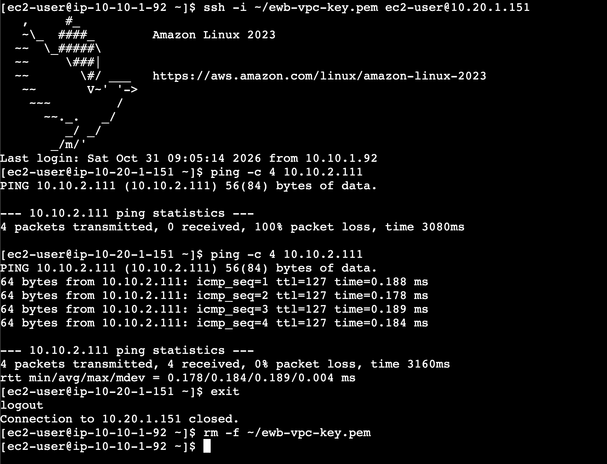
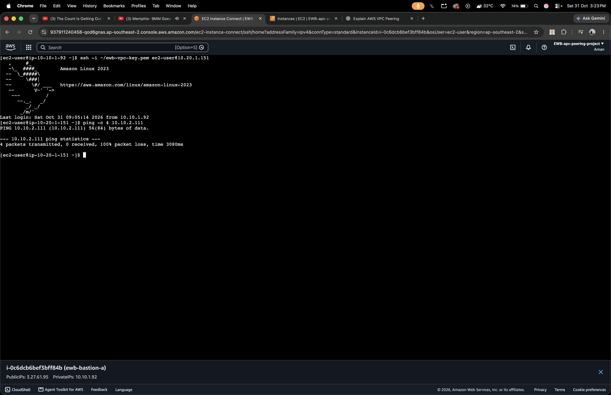

# AWS VPC Peering Project

### Secure Private Communication Between Two Amazon VPCs

**Built with Amazon Web Services ☁️**

---

## 📌 Project Overview

A hands-on AWS networking project demonstrating secure communication between two isolated Virtual Private Clouds (VPCs) using **VPC Peering**.

The project establishes private connectivity between EC2 instances through route tables, security groups, and a bastion host. Network communication is validated through SSH and bidirectional ICMP testing.

## 🏗️ Network Architecture

| Component | Configuration |
|---|---|
| VPC A | `10.10.0.0/16` |
| VPC B | `10.20.0.0/16` |
| Public Subnet A | `10.10.1.0/24` |
| Private Subnet A | `10.10.2.0/24` |
| Private Subnet B | `10.20.1.0/24` |
| AWS Region | Sydney (`ap-southeast-2`) |
| Connectivity | VPC Peering |

### Infrastructure Components

- **VPC A:** Public and private subnet architecture.
- **VPC B:** Private-only network architecture.
- **Bastion Host:** Secure SSH entry point.
- **VPC Peering:** Private communication between both VPCs.
- **Route Tables:** Bidirectional network routing.
- **Security Groups:** Controlled SSH and ICMP traffic.

## 🔄 Connectivity Testing

The following tests were performed to validate private network communication:

| Test | Result |
|---|---|
| Forward Ping (App-A → App-B) | ✅ Successful |
| Reverse Ping (App-B → App-A) | ✅ Successful |
| SSH to private EC2 instances | ✅ Successful |
| Controlled ICMP failure | ✅ Verified |
| Connectivity recovery | ✅ Verified |

## 📸 Project Screenshots

### 01. AWS Infrastructure

### 02. VPC Peering Configuration

### 03. EC2 Connectivity Testing

## 📄 Project Documentation

The detailed project report contains the network architecture, AWS configurations, route tables, security groups, SSH validation, connectivity testing, and implementation evidence.

### 📘 Complete Project Report

**[📖 VIEW FULL PROJECT REPORT](./report/)**

*Open the report folder to access the PDF documentation.*

## 🛠️ Technologies Used

- Amazon Web Services (AWS)
- Amazon VPC
- VPC Peering
- Amazon EC2
- Security Groups
- Route Tables
- Linux
- SSH

## 🎯 Key Learnings

- Designing isolated cloud networks.
- Establishing VPC Peering connections.
- Configuring bidirectional network routes.
- Managing private EC2 connectivity.
- Implementing security group restrictions.
- Troubleshooting network connectivity using ICMP and SSH.

## 👨‍💻 Author

**Aman Mishra**  
B.Sc. Information Technology

---

### Built with Amazon Web Services

*Designed, configured, and tested by Aman Mishra.*

